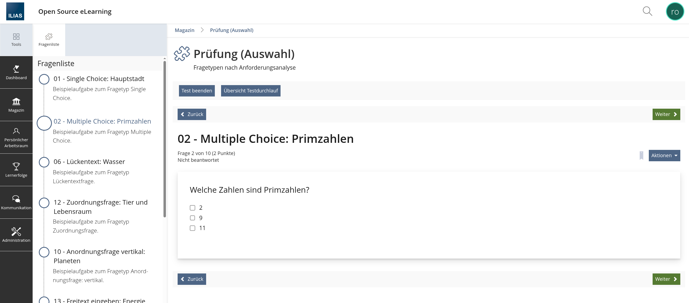
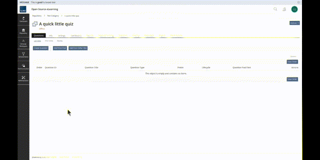
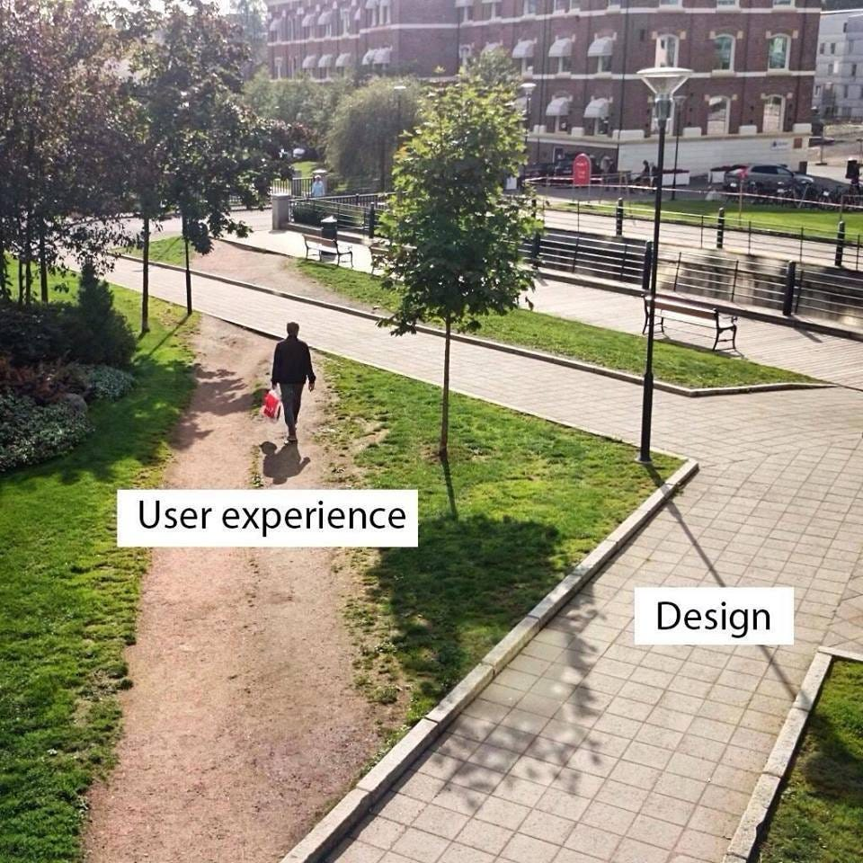
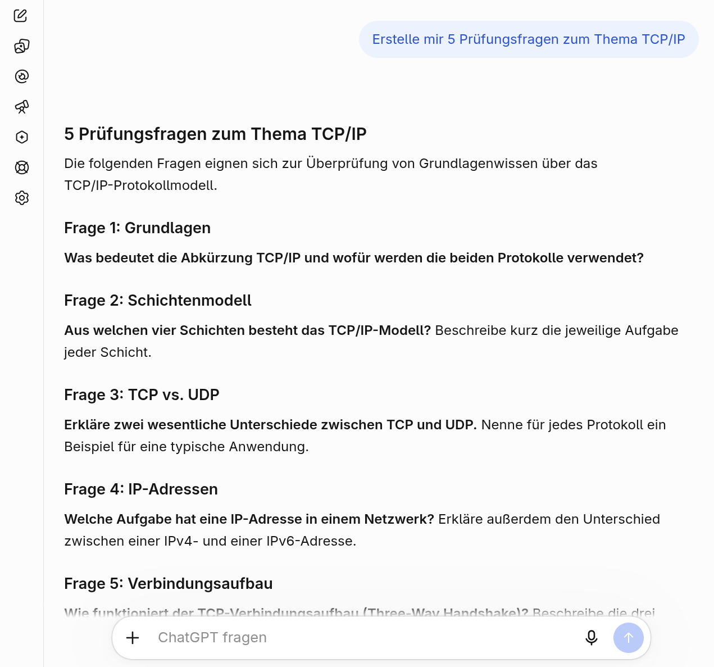
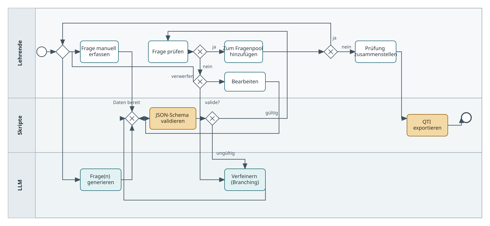
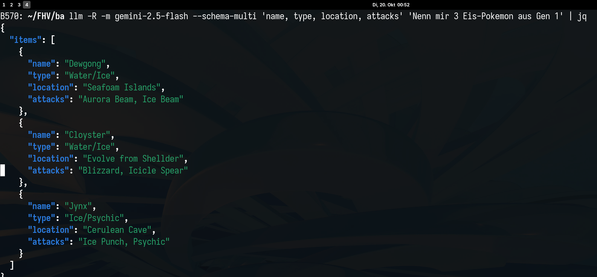

# LENA
**L**LM-gestützte **E**rstellung und **N**achbearbeitung von **A**ufgaben

::: notes
INNA, Indoor Navigation, herinnen (Dialekt)
ISO 9241-110 Selbstbeschreibungsfähigkeit
:::

# 1. Stand der Technik

## Integrierte Lern-, Informations- und Arbeitskooperations-System


## ILIAS

- europäische Software 🇪🇺
- **Multi-Page-Application (MPA)**
- tausende aktive Installationen
- Millionen von Nutzer:innen

## Prüfungen im ILIAS ablegen



## Prüfungsfragen im ILIAS anlegen

::: {#clicks}
{width="100%"}

[Report: Creating Question (ILIAS Test & Assessment)](https://github.com/catenglaender/public-notes/blob/main/ILIAS-development/2023/Creating-Questions-in-TA/Report_Creating-Questions-in-TA.md)
:::

## Schlechte Bedienbarkeit

Mentale Modelle [@MentalModelsUser]
: Erwartungshaltung, wie ein System funktioniert – geprägt durch frühere Erfahrungen, Alltagskonzepte und erlernte Standards.

Hohe Interaktionskosten [@InteractionCostDefinition]
: Beschreibt die Summe des physischen und mentalen Aufwands, den ein Nutzer aufbringen muss, um ein bestimmtes Ziel mit einem System zu erreichen

---



::: notes
man geht dann doch einen anderen Weg
::: 

---

## QTI

Question and Test Interoperability (QTI) specification[@QuestionTestInteroperability]

- einheitliches XML-Format, plattformunabhängig (lol)
- für Fragen, Antworten, Auswertungen, Prüfungen

ILIAS kann QTI Dateien **importieren** und exportieren

::: notes
ist alles andere als plattformunabhängig; 
Standards sind dazu da um gebrochen zu werden;
jeder kocht sein eigenes Süppchen;
:::

## Beispiel: qti.xml

```xml
<?xml version="1.0" encoding="UTF-8"?>
<!DOCTYPE questestinterop SYSTEM "ims_qtiasiv1p2p1.dtd">
<questestinterop>
  <item ident="frage1" title="Hauptstadt">
    <presentation>
      <material><mattext>Was ist die Hauptstadt von Frankreich?</mattext></material>
      <response_lid ident="antwort" rcardinality="Single">
        <render_choice>
          <response_label ident="Berlin">
            <material><mattext>Berlin</mattext></material>
          </response_label>
          <response_label ident="Madrid">
            <material><mattext>Madrid</mattext></material>
          </response_label>
          <response_label ident="Paris">
            <material><mattext>Paris</mattext></material>
          </response_label>
        </render_choice>
      </response_lid>
    </presentation>
    <resprocessing>
      <outcomes><decvar maxvalue="1" minvalue="0" varname="SCORE" vartype="Integer"/></outcomes>
      <respcondition>
        <conditionvar><varequal respident="antwort">Paris</varequal></conditionvar>
        <setvar varname="SCORE" action="Set">1</setvar>
      </respcondition>
    </resprocessing>
  </item>
</questestinterop>
```

## Chatbots



::: notes
Verantwortungsvoller Umgang mit KI gilt auch für Lehrkräfte
:::

## Forschungslücke?

Es fehlt eine ausgereifte, benutzerfreundliche Lösung, die den **gesamten Prozess** – von der Aufgabenerstellung (im Dialog mit einem Chatbot), über die Evaluation und Auswahl, bis hin zum Export für ILIAS – abdeckt

::: {style="font-size: 60%;"}
(Eine Schwachstelle bzw. ungelöstes Problem im aktuellen Stand der Technik)
<https://www.scribbr.at/aufbau-und-gliederung-at/forschungsluecke/>
:::

::: notes
ganz klar benennen bzw. definieren,

der Auffassung sein

erforderlich um daraus Forschungsfrage abzuleiten

Prozedere von A-Z
:::

# 2. Ziele


1. Lehrende dabei unterstützen, Prüfungsaufgaben mit KI zu erstellen, zu prüfen, auszuwählen und zu überarbeiten.
2. Die Aufgaben als QTI-Datei nach ILIAS exportieren.
3. Den Aufwand mit dem bisherigen Erstellungsprozess in ILIAS vergleichen.

::: notes
wichtig: NICHT ersetzen
:::

## Forschungsfrage

::: {style="font-size: 80%;"}
Wie verändert eine KI-gestützte Anwendung den Aufwand für Lehrende bei der 

- Erstellung,
- Evaluation,
- Bearbeitung
- und Auswahl

von Prüfungsaufgaben im Vergleich zu ILIAS?
:::

## Anforderungsanalyse

- **Fragetypen**
- **Prozessmodellierung**
- für "unser" ILIAS 10.11 (2026-10-03) mit QTI 1.2.1
- keine anderen Learning Management Systeme (LMS)
- keine anderen Formate (HTML, PDF, usw.)
- keine Generative UI (siehe json-render)
- kein Import bestehender Fragen

## Fragetypen

:::: {.columns}
::: {.column}
- Single Choice
- Multiple Choice
- Kprim
- ~~Fehler/Worte markieren~~
- ~~Hotspot/Imagemap~~
- Lückentext
- Numerische Antwort
:::

::: {.column}
- (Formelfrage)
- Begriffe benennen
- Anordnungsfrage vertikal
- ~~Anordnungsfrage horizontal~~
- Zuordnungsfrage
- Freitext eingeben
- ~~Datei hochladen~~
- ~~Long Menu~~
:::
::::

## Prozessmodellierung

{width="100%"}

# 3. Methodik

## Prototypische Umsetzung

- React / Next.js
- `useChat` und `useObject` hooks[@AISDKUI]
- JSON Schema[@JSONSchemaSpecification]
- Vercel AI Gateway

::: notes
Wie baue ich die Lösung?
:::

---

{width="100%"}

## Evaluierung

Technisch
: Lassen sich die exportierten Aufgaben in ILIAS importieren?

Bedienbarkeit
: Lehrende bearbeiten typische Aufgaben mit dem Prototyp und mit ILIAS.

Vergleich
: zB Bearbeitungszeit, Interaktionskosten, Fehlerquote, subjektiv wahrgenommener Aufwand

::: notes
Wie überprüfe ich die Lösung?
:::


# Literaturverzeichnis

::: {#refs}
:::
