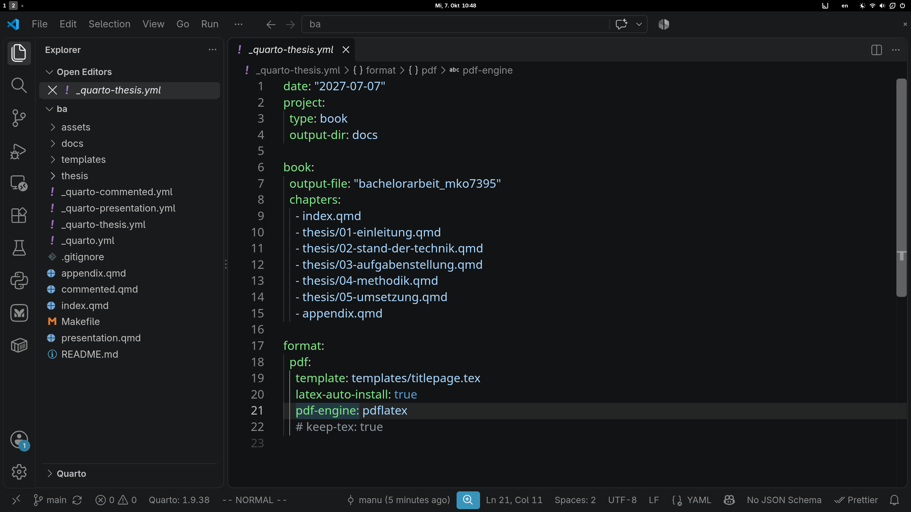
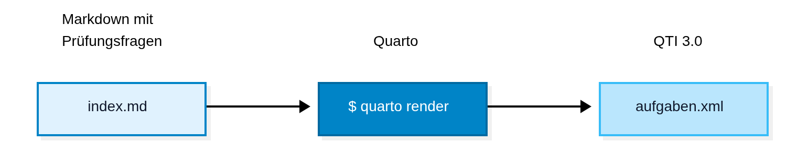
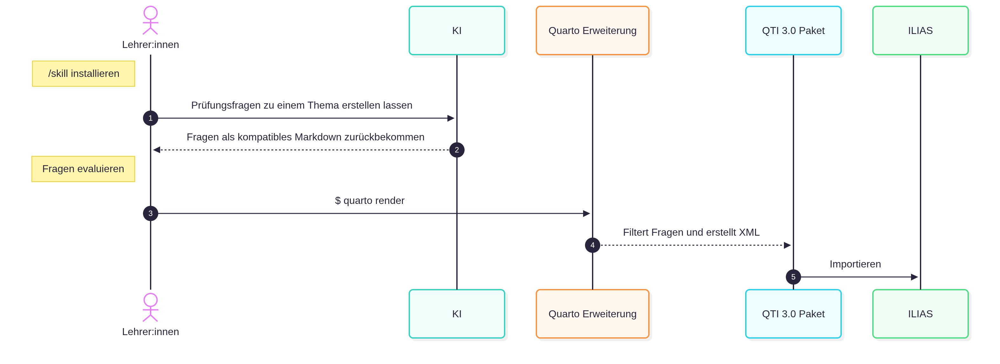

# 1. Stand der Technik

## Integrierte Lern-, Informations- und Arbeitskooperations-System


## ILIAS

- europäische Software 🇪🇺
- **Multi-Page-Application (MPA)**
- tausende aktive Installationen
- Millionen von Nutzer:innen
- ca. 2 Mio. LOC

## Prüfungen im ILIAS ablegen


## Prüfungsfragen im ILIAS anlegen

::: {#clicks}
{width="100%"}

[Report: Creating Question (ILIAS Test & Assessment)](https://github.com/catenglaender/public-notes/blob/main/ILIAS-development/2023/Creating-Questions-in-TA/Report_Creating-Questions-in-TA.md)
:::

## Schlechte Bedienbarkeit

Mentale Modelle [@MentalModelsUser]
: Erwartungshaltung, wie ein System funktioniert – geprägt durch frühere Erfahrungen, Alltagskonzepte und erlernte Standards.

Hohe Interaktionskosten [@InteractionCostDefinition]
: Beschreibt die Summe des physischen und mentalen Aufwands, den ein Nutzer aufbringen muss, um ein bestimmtes Ziel mit einem System zu erreichen

---


---

## Alternative: QTI

Question and Test Interoperability (QTI) specification

> Er definiert ein **einheitliches XML-Format**, mit dem Testfragen, Antworten,
> Auswertungsschemata und komplette Prüfungen **plattformunabhängig** gespeichert
> und ausgetauscht werden können.

ILIAS kann QTI 3.0 Dateien importieren und exportieren

## Beispiel: qti.xml

```xml
<?xml version="1.0" encoding="UTF-8"?>
<qti-assessment-item xmlns="http://www.imsglobal.org/xsd/imsqtias_v3p0">

  <qti-item-body>
    <p>Was ist die Hauptstadt von Frankreich?</p>

    <qti-choice-interaction>
      <qti-simple-choice>Madrid</qti-simple-choice>
      <qti-simple-choice>Berlin</qti-simple-choice>
      <qti-simple-choice>Paris</qti-simple-choice>
      <qti-simple-choice>Rom</qti-simple-choice>
    </qti-choice-interaction>
  </qti-item-body>

  ...
</qti-assessment-item>
```

## Forschungslücke?

Schwachstelle bzw. ungelöstes Problem im aktuellen Stand

1. ILIAS ist schwierig zu bedienen
2. XML ist schwierig zu lesen

# 2. Aufgabenstellung

## Aufgabenstellung

Als Lehrkraft möchte ich Prüfungsfragen mit Markdown erstellen
um sie ins ILIAS per QTI 3.0 zu importieren.

1. **"weil's bequemer isch"**
2. um Fragen per KI generieren zu lassen

## Anforderungsanalyse

1. Nur die wichtigsten *Interaction Types* [@interactionTypes]
    - Single Choice / Multiple Choice
    - Zuordnungsaufgaben / Zuordnungsmatrix (Kprim-Fragen)
    - Sortieraufgaben
    - Freitext
2. Well-formed und valides XML [@wellformedValidXml]
3. Keine Ausgabe in andere Formate (HTML, PDF) erforderlich

## Berechtigte Kritik

- Warum nicht einfach das bestehende UI überarbeiten?
- Warum nicht einfach die KI ein QTI-Paket erstellen lassen?

# 3. Methodik

## Herangehensweise



:::{style="font-size:60%"}
Post-Render [@postRender]

1. Validieren mit `$ xmllint --noout --schema schema.xsd aufgaben.xml`
2. Zusammen mit `imsmanifest.xml` zippen mit `zip -r ../aufgaben.zip .`
:::

## Quarto-Erweiterung

techn. wissenschaftliches Publishing-System

```
quarto-project/
├── _extensions
│   └── qti
│       ├── _extension.yml
│       ├── filter.lua
│       └── template.xml
├── index.qmd
└── _quarto.yml
```

- Custom Format
- Pandoc Filter

## xkcd on Standards [@XkcdStandards] 


siehe RFC 7763 [@RFC7763Text] und 7764 [@RFC7764Guidance]

::: notes
fragmentiert
:::

# Prüfungsfragen per KI generieren



<!-- - KI per `/skill` instruieren [@skills]
- Markdown ist leichter zu lesen als XML
- **Evaluierung der Fragen muss trotzdem stattfinden**
- die Quarto-Erweiterung verhält sich stets deterministisch -->

# Literaturverzeichnis

::: {#refs}
:::
